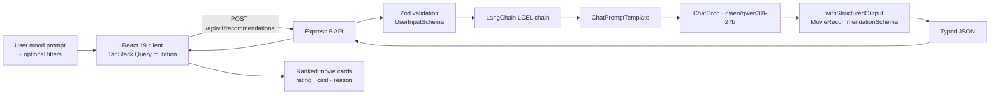

<div align="center">

# AI Cinema Recommendation System

**AI-powered movie recommendation engine built with LangChain.**

Describe a mood, a vibe, or a plot in plain English — get back a ranked list of movies with cast, ratings, and an AI-written reason for every pick.

[](https://react.dev)
[](https://www.typescriptlang.org)
[](https://expressjs.com)
[](https://js.langchain.com)
[](https://groq.com)
[](https://tailwindcss.com)
[](https://pnpm.io)
[](./server-node-typescript/package.json)

</div>

---

## Overview

**CineMind AI** turns a free-text prompt like _"mind-bending sci-fi thrillers with a plot twist"_ into a structured, render-ready list of movie recommendations — each with a title, release year, genre, cast, an IMDB-style rating, and a short reason explaining why it fits.

What makes it interesting is what it **doesn't** need: there is no movie database to seed, no vector store to build, and no embeddings pipeline to run. A single **LangChain LCEL chain** calls a Groq-hosted LLM and enforces a **Zod schema** on the response, so the API returns validated, typed JSON straight to the UI. One API key, zero data pipelines.

> **Note on approach:** recommendations are generated from the LLM's own knowledge via a structured-output call — this is intentionally _not_ a RAG pipeline (see [Roadmap](#roadmap) for where that could go next).

---

## Features

- **Mood-to-movie in one box** — describe a feeling, a genre mashup, or a plot device; get curated results instantly.
- **Optional fine-tune filters** — narrow by genre (13 options), language (8 options), release year, and result count (3–20 in the UI).
- **Quick-prompt chips** — one-click starter prompts so you can demo the engine without thinking.
- **Structured LLM output, end to end** — `withStructuredOutput()` + Zod replaces brittle regex parsing with typed objects, validated on the server and rendered directly.
- **Provider-flexible** — runs on Groq (`qwen/qwen3.8-27b`) out of the box, with a Google Gemini connector ready to swap in.
- **Cinematic dark UI** — amber-on-charcoal theme, rating-coded badges (emerald / amber / cyan), animated skeleton loaders, and ambient gradient backdrops.
- **Hardened Express API** — Zod-validated environment at boot, CORS origin allowlist, 10 KB body limits, centralized error handling, and graceful shutdown with connection draining.
- **Strict TypeScript everywhere** — ESM backend with `strict` + `noUncheckedIndexedAccess`, and a path-aliased React 19 client.

---

## How It Works



1. The client collects the prompt and filters, then fires a TanStack Query mutation to `POST /api/v1/recommendations`.
2. Express validates the payload with `UserInputSchema.parse(req.body)` before it reaches the service layer.
3. The LangChain chain pipes a chat prompt template into the model, then parses the reply straight into typed objects.
4. The API wraps everything in a consistent envelope and the UI renders ranked, rating-coded cards.

The entire inference step is one composable pipeline:

```ts
// server-node-typescript/src/integrations/langchain/services.ts
const structuredModel = LLM.withStructuredOutput(MovieRecommendationSchema);

export async function getCinemaRecommendation(payload: UserInputSchemaType) {
    const promptChain = promptTemplate.pipe(structuredModel);
    return promptChain.invoke({
        userPrompt: payload.userPrompt,
        genre: payload.genre,
        language: payload.language,
        year: payload.year,
        count: payload.count,
    });
}
```

---

## Tech Stack

### Backend — `server-node-typescript`

| Layer             | Choice                                                                     |
| ----------------- | -------------------------------------------------------------------------- |
| Runtime           | Node.js (>= 20.6, native `--env-file` support)                             |
| Server            | Express 5                                                                  |
| AI orchestration  | LangChain 1.x + `@langchain/core`                                          |
| LLM provider      | `@langchain/groq` — `ChatGroq` with `qwen/qwen3.8-27b` (temperature `0.6`) |
| Optional provider | `@langchain/google` — `ChatGoogle` / Gemini (wired, commented out)         |
| Validation        | Zod 4 (request body + LLM structured output + env schema)                  |
| Language          | TypeScript (ESM, NodeNext)                                                 |
| Dev tooling       | `tsx`, `nodemon`                                                           |

### Frontend — `client-react-typescript`

| Layer          | Choice                                                     |
| -------------- | ---------------------------------------------------------- |
| Framework      | React 19                                                   |
| Meta-framework | TanStack Start (SSR)                                       |
| Routing        | TanStack Router (file-based)                               |
| Server state   | TanStack Query (`useMutation`)                             |
| Styling        | Tailwind CSS v4                                            |
| UI kit         | shadcn/ui-ready (`components.json`) + `lucide-react` icons |
| HTTP           | Axios                                                      |
| Build          | Vite 8                                                     |
| Quality        | ESLint 9 + Prettier                                        |

---

## Project Structure

```
cinema-recommendation-langchain/
├── server-node-typescript/                 # Express + LangChain backend
│   ├── src/
│   │   ├── app.ts                          # Express app: CORS, parsers, route mounting
│   │   ├── server.ts                       # Entrypoint + graceful shutdown
│   │   ├── config/
│   │   │   ├── env.ts                      # Zod-validated environment
│   │   │   └── cors.ts                     # Origin allowlist
│   │   ├── routes/                         # health + recommendations routers
│   │   ├── _module/
│   │   │   ├── health/health.controller.ts
│   │   │   └── recommendations/
│   │   │       ├── recommendation.controller.ts
│   │   │       ├── recommendation.service.ts
│   │   │       └── recommendation.schema.ts   # UserInput + Movie Zod schemas
│   │   ├── integrations/langchain/
│   │   │   ├── model.ts                    # ChatGroq LLM instance
│   │   │   ├── template.ts                 # ChatPromptTemplate
│   │   │   └── services.ts                 # LCEL chain + structured output
│   │   └── utils/                          # AppError, handlers, shutdown
│   └── package.json
│
└── client-react-typescript/                # React 19 frontend
    ├── src/
    │   ├── routes/                         # File-based routes (__root, index)
    │   ├── components/
    │   │   ├── CinemaApp.tsx                # Main page composition
    │   │   ├── RecommendationForm.tsx       # Prompt + filters + quick prompts
    │   │   ├── MovieCard.tsx                # Ranked result card
    │   │   └── SkeletonCard.tsx             # Loading placeholders
    │   ├── services/recommendationApi.ts    # Axios client
    │   ├── types/recommendation.ts          # Shared response types
    │   └── styles.css                       # Tailwind + theme
    └── package.json
```

---

## Getting Started

### Prerequisites

- **Node.js >= 20.6** (required for the native `--env-file` flag)
- **pnpm** — enable via `corepack enable`
- A **free Groq API key** — grab one at [console.groq.com](https://console.groq.com)

### 1. Clone the repo

```bash
git clone https://github.com/arkajitroy/cinema-recommendation-langchain.git
cd cinema-recommendation-langchain
```

### 2. Run the backend

```bash
cd server-node-typescript
pnpm install
```

Create a `.env` file:

```env
PORT=8000
NODE_ENV=development
CORS_ORIGINS=http://localhost:3000
GROQ_API_KEY=your_groq_api_key_here
```

Then start the dev server:

```bash
pnpm dev
# [INFO] Server running on port 8000
```

### 3. Run the frontend

In a second terminal:

```bash
cd client-react-typescript
pnpm install
pnpm dev
```

The client boots on **http://localhost:3000** and talks to the API at **http://localhost:8000** by default. That's it — open the browser and start prompting.

> **Swap the LLM provider:** open `server-node-typescript/src/integrations/langchain/model.ts`, comment out the `ChatGroq` instance, and uncomment the `ChatGoogle` one (set `GOOGLE_API_KEY` and pick a Gemini model).

### Production builds

```bash
# backend
cd server-node-typescript && pnpm build && pnpm start

# frontend
cd client-react-typescript && pnpm build && pnpm preview
```

---

## API Reference

Base URL: `http://localhost:8000`

### `GET /health-check`

Liveness probe.

```json
{
    "status": "ok",
    "timestamp": "2026-01-01T12:00:00.000Z",
    "uptime": 123.45,
    "environment": "development",
    "memoryUsage": { "...": "..." }
}
```

### `POST /api/v1/recommendations`

Generate movie recommendations from a prompt and optional preferences.

**Request body**

| Field        | Type     | Required | Description                              |
| ------------ | -------- | -------- | ---------------------------------------- |
| `userPrompt` | `string` | Yes      | Free-text mood / vibe / plot description |
| `genre`      | `string` | Yes      | Preferred genre                          |
| `language`   | `string` | Yes      | Preferred language                       |
| `year`       | `string` | Yes      | Release era / year hint                  |
| `count`      | `number` | Yes      | Number of recommendations                |

```json
{
    "userPrompt": "Mind-bending sci-fi thrillers with a plot twist",
    "genre": "Sci-Fi",
    "language": "English",
    "year": "2015",
    "count": 5
}
```

**Response**

```json
{
    "success": true,
    "message": "Recommendation successful",
    "data": {
        "recommendations": [
            {
                "title": "Arrival",
                "year": "2016",
                "genre": "Sci-Fi, Drama, Mystery",
                "caste": "Amy Adams, Jeremy Renner, Forest Whitaker",
                "reason": "A cerebral first-contact story defined by its emotional, time-bending twist.",
                "rating": 7.9
            }
        ]
    }
}
```

**Error shape** — validation failures return `400` with `fieldErrors`; unmatched routes return `404`; unexpected failures return `500`:

```json
{
    "success": false,
    "message": "Validation failed",
    "errors": [{ "field": "count", "message": "Expected number, received string" }]
}
```

---

## Environment Variables

### Backend (`server-node-typescript/.env`)

| Variable         | Required | Default                                       | Description                                       |
| ---------------- | -------- | --------------------------------------------- | ------------------------------------------------- |
| `GROQ_API_KEY`   | Yes      | —                                             | Groq API key used by `ChatGroq`                   |
| `PORT`           | No       | `3000`                                        | API port (use `8000` to match the client default) |
| `CORS_ORIGINS`   | No       | `http://localhost:3000,http://localhost:5173` | Comma-separated allowlist of frontend origins     |
| `NODE_ENV`       | No       | `development`                                 | `development` \| `production` \| `test`           |
| `GOOGLE_API_KEY` | No       | —                                             | Only needed if you switch to the Gemini provider  |
| `DATABASE_URL`   | No       | —                                             | Reserved; not currently used                      |

### Frontend (`client-react-typescript/.env`)

| Variable       | Required | Default                 | Description                 |
| -------------- | -------- | ----------------------- | --------------------------- |
| `VITE_API_URL` | No       | `http://localhost:8000` | Base URL of the backend API |

---

## Roadmap

- [ ] **RAG mode** — retrieve over a real movie corpus (TMDB or a local dataset) with a vector store instead of relying solely on model knowledge
- [ ] **Streaming responses** — stream recommendations token-by-token for instant feedback
- [ ] **Conversation memory** — follow-up prompts like _"more like #2"_
- [ ] **Watch-now links** — deep-link each recommendation to a streaming provider
- [ ] **Favorites & shareable lists**
- [ ] **Docker Compose** — one-command local stack
- [ ] **Tests & CI** — unit tests for the chain + a GitHub Actions pipeline

---

## License

Released under the [ISC License](./server-node-typescript/package.json).

<div align="center"><sub>Built with LangChain, Express, and React 19 — recommendations generated by an LLM, not a database.</sub></div>
